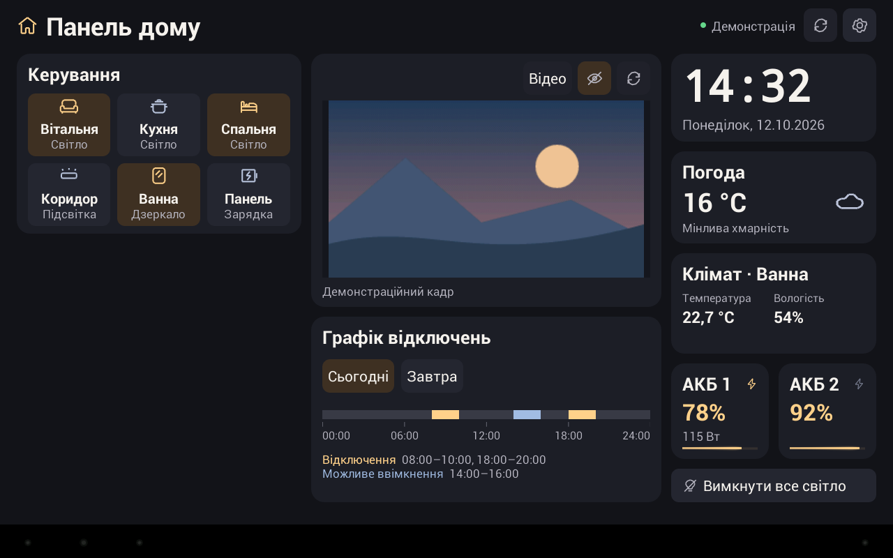

# Панель дому для Android 4.1

Повноекранна панель Home Assistant для Android 4.1 (API 16). Перевірена на Ainol Novo 10 Hero QuadCore. Показує стан світла й розеток, відео, календар відключень, погоду, клімат і заряд станцій.



## Налаштування під свій дім

Відкрийте [PanelConfig.java](src/ua/hapanel/PanelConfig.java) і замініть демонстраційні ідентифікатори на свої. У списку `ROOMS` задайте кімнати й кнопки з повними ID на кшталт `light.kitchen` або `switch.hall_light`. Плитки з іконкою зарядки виключені з команди «Вимкнути все світло» та нічної перевірки.

Погода, клімат, календар, камера й станції потребують відповідних сутностей у Home Assistant. За потреби змініть `TIME_ZONE`. Налаштування з цього файлу застосовуються під час збірки APK. Адресу сервера та токен введіть у налаштуваннях на планшеті.

## Збірка на Windows

`build.ps1` використовує PowerShell, JDK 17, Android SDK Platform 16 і Build Tools 35.0.0. Шляхи до JDK і SDK задані на початку скрипта. Розмістіть JDK у `work/jdk17/`, а Android SDK у `work/sdk/` відповідно до цих шляхів.

Для відтворення збірки покладіть у `work/video-libs/` JAR-файли модулів ExoPlayer 2.19.1 (`common`, `container`, `core`, `database`, `datasource`, `decoder`, `extractor`, `rtsp`) та їхні залежності. Для артефактів AAR витягніть `classes.jar` і перейменуйте його за модулем. Поточна збірка використовує такі версії супутніх бібліотек:

- AndroidX Annotation 1.3.0, Annotation Experimental 1.1.0, Collection 1.0.0, Concurrent Futures 1.0.0, Core 1.8.0, Lifecycle Common і Runtime 2.3.1, Arch Core Common і Runtime 2.1.0, VersionedParcelable 1.1.1.
- Guava 31.1-android, FailureAccess 1.0.1, Java-WebSocket 1.5.7 і SLF4J API 2.0.6.

Для Java-WebSocket на API 16 потрібна локальна правка. У вихідному файлі `org/java_websocket/util/Charsetfunctions.java` версії 1.5.7 замініть імпорт і звернення до `java.nio.charset.StandardCharsets` на `ua.hapanel.LegacyCharsets`. Скомпілюйте цей файл із `src/ua/hapanel/LegacyCharsets.java` для Java 8, використовуючи бібліотеку Java-WebSocket у classpath. Оновіть у JAR лише `org/java_websocket/util/Charsetfunctions.class`. Наявний JAR у локальній збірці вже містить цю правку.

```powershell
.\build.ps1
.\work\sdk\platform-tools\adb.exe install -r .\outputs\ha-panel.apk
```

Під час першої збірки скрипт генерує локальний ключ підпису `work/build-signing.p12`. Для оновлення вже встановленого APK потрібен той самий ключ. Зберігайте його окремо. Адресу Home Assistant і токен задайте у вікні підключення на планшеті.

## Відеосервіс Home Assistant

`ha-app/ainol_camera_relay/` містить локальний застосунок Home Assistant OS для amd64. FFmpeg перекодовує потік камери в H.264 Baseline 640×360 при 10 кадрах/с, а MediaMTX віддає RTSP. Під час збою панель показує кадри з Home Assistant і автоматично відновлює RTSP, щойно потік знову доступний.

Після встановлення застосунку створіть у його папці конфігурації `camera-url` з RTSP-адресою камери та `tablet-ip` з локальною IPv4-адресою планшета. Кожне значення має займати один рядок. Застосунок читає ці файли з `/config`. Укажіть сутність камери в `CAMERA` і адресу відеосервісу в `CAMERA_RTSP` у `PanelConfig.java` перед збіркою.
