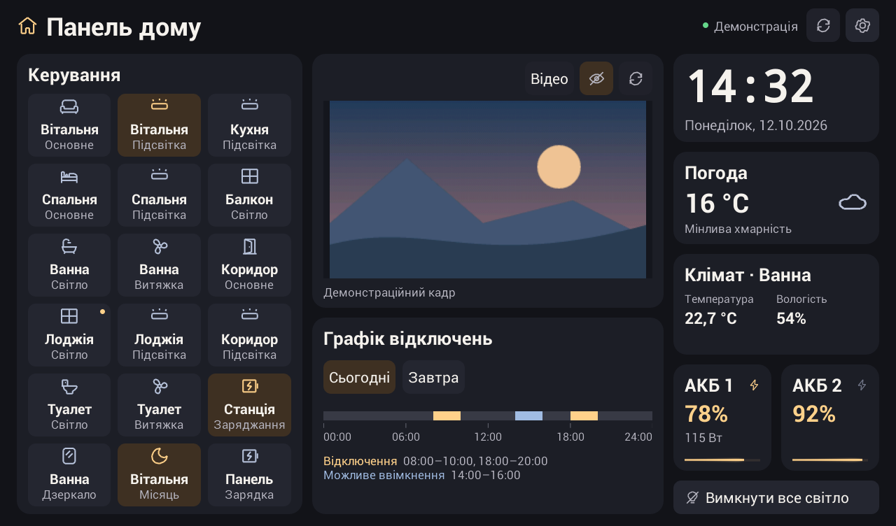

# Панель дому для Android 4

Старий Ainol на Android 4.1 лежав без діла. Офіційний застосунок Home Assistant уже не підтримував цю версію Android, тож разом із Codex я зробив для планшета легку повноекранну панель.

З неї керую світлом і розетками, бачу камеру, графік відключень та заряд станцій.

*Розкладка моєї панелі. Кадр камери й показники на знімку демонстраційні.*

Як я зробив панель і як вона працює

### Від прототипу до панелі

Спочатку я спробував відкрити дашборд Home Assistant у браузері, але на старому Ainol навіть Opera зависала під час запуску. Перший прототип був простим застосунком на Java з кількома кнопками для світла. Ми з Codex збирали APK, встановлювали його через USB і перевіряли зміни на планшеті. Коли базове керування запрацювало, додали камеру, графік відключень і показники зарядних станцій.

### Керування та оновлення

Планшет підключається до Home Assistant через локальну мережу. Натискання кнопки надсилає команду через REST API, а стан пристрою надходить через WebSocket. Якщо я вмикаю світло з телефона, плитка на планшеті теж змінює колір. Через ту саму підписку оновлюються показники станцій. Коли Home Assistant повідомляє про оновлення графіка відключень, панель перечитує календар.

### Камера та нічний режим

На сервері Home Assistant потік камери перекодовується в H.264 Baseline із роздільністю 640 × 360 і частотою 10 кадрів за секунду. Планшет отримує відео через RTSP. Якщо потік обривається, панель показує окремі кадри й пробує відновити відео.

Уночі панель гасить екран, коли все світло вимкнене, а вранці будить його за розкладом Android.

